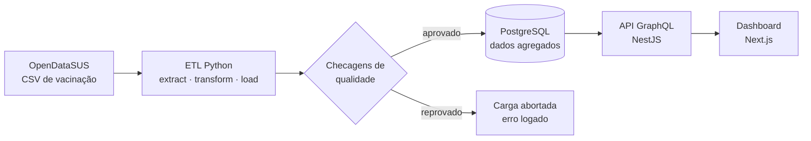

# Painel Saúde Aberta

**Painel de indicadores de vacinação de Pernambuco construído com dados abertos do SUS: do CSV bruto ao gráfico, passando por ETL, API GraphQL e dashboard.**


> 🚧 **Em construção.** Veja a seção [Status](#status) para saber em que ponto o projeto está.

## Por que este projeto

- **Dados públicos reais:** microdados de vacinação (SI-PNI) do OpenDataSUS, com milhões de registros por mês.
- **ETL com qualidade de dados obrigatória:** se uma checagem falhar (nulos em colunas-chave, duplicados, município inexistente, data fora do período), a carga não acontece e o erro é logado com detalhe.
- **Privacidade por design:** o ETL agrega os microdados e grava **apenas contagens** no banco. Nenhum registro individual é armazenado.
- **Carga idempotente:** rodar o ETL duas vezes para o mesmo mês não duplica dados.
- **API GraphQL e dashboard:** filtro por município, gráfico de série temporal e exportação em PDF e XLSX.

## Arquitetura



| Camada | Tecnologia |
|---|---|
| ETL | Python 3.12+, pandas, SQLAlchemy, pytest |
| Banco | PostgreSQL 16 (Docker) |
| API | NestJS, GraphQL (code-first, Apollo) |
| Front | Next.js (App Router), TypeScript, Recharts |
| Exportação | XLSX e PDF |
| CI/Deploy | GitHub Actions, Vercel (front), Railway (API + banco) |

## Escopo do MVP

- **Base:** vacinação (SI-PNI), microdados anonimizados.
- **Recorte:** estado de Pernambuco (PE), ano de 2024.
- **Indicador principal:** doses aplicadas por **município × vacina × mês**.

Só depois que a fatia vertical (ETL → banco → API → tela) funcionar de ponta a ponta, o recorte será ampliado.

## Status

- [x] **Fase 0 — Esqueleto:** repositório, Docker Compose, README
- [ ] **Fase 1 — ETL:** extração, transformação, carga e testes de qualidade
- [ ] **Fase 2 — Modelagem:** schema SQL e ADR-001 (agregação vs. microdados; modelo dimensional)
- [ ] **Fase 3 — API GraphQL:** query `doses`, paginação, DataLoader e testes de integração
- [ ] **Fase 4 — Dashboard:** filtros, série temporal, tabela, exportação XLSX e PDF
- [ ] **Fase 5 — CI e deploy:** GitHub Actions, Vercel, Railway e ETL agendado mensalmente

<!-- TODO (fim da Fase 5): incluir aqui o link do deploy e um GIF do dashboard. -->

## Como rodar

Hoje só o banco de dados está disponível:

```bash
cp .env.example .env
docker compose up -d      # sobe o PostgreSQL 16
```

Os comandos do ETL, da API e do dashboard serão adicionados aqui conforme cada fase ficar pronta.

## Fontes de dados

- [OpenDataSUS](https://opendatasus.saude.gov.br/) — Ministério da Saúde. Registros de vacinação individuais e anonimizados (SI-PNI).
- [IBGE](https://www.ibge.gov.br/) — códigos e nomes de municípios.
- [PySUS](https://github.com/AlertaDengue/PySUS) — biblioteca de apoio opcional para descoberta e download.

Os dados são utilizados conforme os termos de uso do OpenDataSUS. Os créditos também constarão no rodapé do dashboard.

## Documentação

As decisões de arquitetura ficam em [`docs/adr/`](docs/adr/) (Architecture Decision Records).

## Autor

**Swetony Ancelmo** — desenvolvedor Fullstack

- [LinkedIn](https://www.linkedin.com/in/swetony-ancelmo/)
- [Portfólio](https://about-swetony.vercel.app/)
